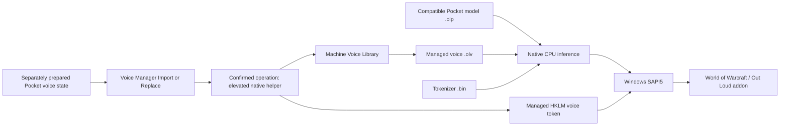

# Out Loud Pocket TTS

Out Loud provides offline English narration for the Out Loud World of Warcraft
addon through a native Pocket TTS engine and Windows SAPI5. Its x64 WPF Voice
Manager imports prepared voices, replaces/removes them, tests speech and exports
test audio to WAV.

The supported production library is machine-wide, normally
`C:\ProgramData\OutLoud\VoiceLibrary`. Voices have immutable library IDs and
HKLM Registry64 SAPI tokens. SAPI display names match validated names entered in
Voice Manager; token IDs retain `OutLoud_Pocket_<library_id>` and Vendor `Out Loud`.



The engine implements the fixed Pocket TTS 3.3.0 English synthesis contract:
FlowLM, FlowSampler, production RNG and Mimi, portable/optional AVX2 CPU kernels,
and mono 24 kHz streaming audio. Python/PyTorch and the upstream Pocket package
are separate preparation/reference tools, not production inference dependencies.
This repository does not contain the WoW addon source or a raw-audio Voice Creator.

## Build and validation

Native builds require Windows x64, CMake 3.24+, Visual Studio 2022 MSVC C++20 tools
and a Windows SDK. WPF requires the .NET 10 SDK on Windows; projects target
`net10.0-windows`. To run, the frontend needs x64 .NET/WindowsDesktop runtimes;
native components need Windows SAPI5, UCRT and Microsoft VC runtime DLLs.
Compatible model/tokenizer/voice files are separate runtime requirements.

Production builds need no generated neural/tokenizer reference fixtures:

```powershell
cmake -S . -B build-production -A x64 -DBUILD_TESTING=OFF -DOUTLOUD_BUILD_DEVELOPMENT_TOOLS=OFF
cmake --build build-production --config Release --parallel --target OutLoudPocketSAPI OutLoudVoiceManagerNative OutLoudVoiceImportHelper outloud-voice-import outloud-voice-library outloud-sapi-voices
.\ui\build.ps1
```

These produce workspace binaries. The UI build consumes the production bridge
and helper and runs its existing fake-service checks without launching the app.
Building neither installs nor registers anything. See the
[build and validation guide](docs/BUILD_AND_VALIDATION_IMPROVEMENTS.md) for WPF
properties, output paths, prerequisites and explicit prepared-reference setup.

Development, after preparing the documented offline references:

```powershell
cmake -S . -B build -A x64 -DBUILD_TESTING=ON
cmake --build build --config Release --parallel
.\scripts\validate.ps1
.\scripts\validate.ps1 -Mode Correctness -List
.\scripts\validate.ps1 -Mode Correctness
```

Defaults: `BUILD_TESTING=ON`, `OUTLOUD_BUILD_DEVELOPMENT_TOOLS=OFF`,
`OUTLOUD_ENABLE_AVX2=ON`. Enable development tools explicitly for research,
listening, baseline comparisons and profiling. Fast validation runs small ordinary
regressions. `Correctness -List` lists without executing; `Correctness` is the
broader opt-in numerical/integration run requiring references and prebuilt frontend
checks. Missing requirements fail visibly. Validation never builds, exports,
downloads, elevates or benchmarks.

## Current guides and historical evidence

| Current topic | Guide |
| --- | --- |
| Runtime architecture, ownership and numerical limits | [Native architecture](docs/ARCHITECTURE.md) |
| Native operational error records and privacy | [Error logging](docs/NATIVE_ERROR_LOGGING.md) |
| Voice Manager operations, testing and recovery | [Voice Manager guide](docs/VOICE_MANAGER_GUIDE.md) |
| Storage and machine security | [Voice Library](docs/VOICE_LIBRARY.md), [machine library](docs/MACHINE_VOICE_LIBRARY.md) |
| Token identity and diagnostics | [Managed SAPI voices](docs/MULTI_VOICE_SAPI.md) |
| Manual shared-engine staging/signing/registration | [SAPI adapter and deployment](docs/SAPI_ADAPTER.md) |
| Binary containers and prepared-voice conversion | [OLP/OLV format](docs/NATIVE_ASSETS.md), [native importer](docs/VOICE_IMPORT.md) |
| Build and validation procedures | [A11/A12 guide](docs/BUILD_AND_VALIDATION_IMPROVEMENTS.md) |

Milestone records retain historical commands, measurements and conclusions.
[A17](docs/DOCUMENTATION_FINALIZATION_A17.md) classifies the documents and records
current-source checks. Optimization evidence remains in
[A06](docs/PERFORMANCE_OPTIMIZATION_A06.md), [A08](docs/PERFORMANCE_OPTIMIZATION_A08.md)
and [A09](docs/PERFORMANCE_OPTIMIZATION_A09.md).

## Development and distribution status

Native synthesis, SAPI and Voice Manager workflows are implemented; the user
reports working installed SAPI/WoW integration. Latest workspace optimizations
have focused validation but have not been deployed and tested through installed
WoW/SAPI. No post-optimization end-to-end WoW performance result is claimed.

A11/A12 recorded successful production/WPF Release x64 builds and **4/4 fast
checks**. Its **31 broader entries were listed, not executed**. Debug and
AVX2-disabled builds remain unverified in that phase. Explicit broader correctness
and installed-host validation remain pre-release activities.

This is a development project, not a complete installable distribution. **A03**
remains packaging, installer/runtime handling, signing, install/uninstall and
upgrades. **A04** requires project-license decisions, complete notices/attribution,
and model/voice redistribution review. [RNG notices](RNG_NOTICES.md) cover that
component only; no complete-product license or blanket asset redistribution
permission is established or selected here.
