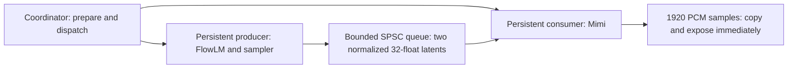

# Step 2J: resident two-stage streaming workers

This step adds real overlap between the unchanged Step 2I FlowLM/sampler and
Mimi kernels. One request is one already prepared text segment with externally
supplied noise. Performance numbers below describe this development host and
canonical workload; they are observations, not correctness baselines or CPU
requirements. Step 2I was committed as `8d98435`, and the tree was clean at
the start. No upstream benchmark was rerun.

## Architecture and ownership

`outloud_workers` exposes [WorkerPipeline](../engine/include/outloud/worker_pipeline.hpp).
Construction allocates state and starts exactly two resident `std::thread`s.
A condition-variable startup barrier confirms both have entered their job
loops before construction returns. The caller coordinates requests and waits
for completion; it performs no neural computation.



The producer exclusively computes and resets its backbone, suffix caches,
sampler, candidate and previous latent. The consumer exclusively computes and
resets its decoder, K/V caches, convolution carry and scratch. Both share the
original read-only model mapping; the voice prefix remains read-only and shared.
The coordinator reads completed states only after both workers have acknowledged
completion. Separate result fields and audit counters have separate writers;
the completion mutex publishes them to the coordinator. There is no concurrent
vector resizing or shared neural scratch.

The queue is a mutex-protected bounded SPSC ring of two `std::array<float,32>`
items, **256 bytes of payload**, with head/count indices. Items have no heap
allocation or unnecessary metadata. The consumer copies one item to its own
128-byte local latent and frees that slot before decoding. The producer keeps
its own previous latent for autoregressive feedback and can compute candidate
N+1 while Mimi decodes N. It waits only when pushing into a full queue. The
47th computed canonical candidate consumes its noise/cache position but is
discarded before enqueueing, exactly as in sequential generation.

A job condition variable wakes resident workers for reset/compute epochs. A
queue condition variable waits for data/capacity, producer completion or an
error. A completion condition variable waits for both workers. Predicate waits
and mutex publication prevent lost notifications; no polling, spinning or
Sleep loop runs while waiting. Capacity stays **two**; no capacity sweep was
needed. Larger queues cannot remove the measured limiting-stage compute.

## Request lifecycle, streaming and shutdown

Construct with text/frame allocation limits (canonical: 20 and 109). Call
`prepare(tokens, noise, destination, options, sink, context, observer)` on the
single coordinator. It checks tokens/options/output capacity, clears the queue,
publishes reset jobs, and waits while each owner resets its own neural state.
FlowLM restores the immutable voice prefix; Mimi resets offset/carry and hides
old K/V contents. Reset is outside request timing. Inputs and destination are
borrowed and must survive until `run()` returns. A fresh fixture noise source
is supplied per request. Output capacity must cover the configured request
maximum, because EOS is not known beforehand.

`run()` starts timing immediately before dispatch, wakes both workers, then
waits for both completions. The producer executes unchanged text prefill and
discarded sampling, BOS, native normalized feedback, stop policy and sampler
helpers. The consumer decodes exactly one latent per call, copies exactly
1920 samples into the next preallocated destination view, and invokes an
optional `PCMFrameSink` immediately. The sink runs on the consumer and must
not reenter the pipeline; spans refer to stable destination storage. No
multi-frame decoder batching, coalescing or full-segment publication delay
is introduced. A blocking sink naturally backpressures the consumer/queue.

The development checker verifies the first sink invocation happens before
generation finishes. Ordinary benchmark requests have neither sink nor
generation observer. The optional generation observer is for exact development
comparison only and runs on the producer.

After completion, workers remain blocked awaiting another job. Another
`prepare` resets all state and request bookkeeping. Exceptions from noise,
compute or a sink are captured, wake queue waits, and cause both workers to
quiesce before `run()` rethrows. Partial output has no successful result;
completed-state access is rejected. A new prepare and fresh noise source
allow a clean retry. Fixture EOF validation runs after request timing; EOF
failure also prevents completed-state access. No public cancellation API is
added.

Destruction sets the internal stop flag, notifies job/queue waits, and joins
both threads. Startup failure joins any worker already created. There are no
detached threads or process-exit helpers. Idle destruction and destruction
after completed/recovered requests are checked. The single-coordinator API
does not permit destruction concurrently with a member call.

## Correctness and allocation audit

The standalone `outloud-worker-check check` compares a clean sequential native
generation/decoder with requests A and B on the same workers. It checks exact
float bits for prefill and every candidate's input, hidden, noise, velocity,
latent and EOS logit; exact classification/latch/emission/offset timeline;
every streaming PCM frame and complete PCM; all six FlowLM K/V suffixes;
both Mimi K/V caches; and all twelve convolution carry states. B follows
two short injected failures (consumer sink and producer noise), also proving
both error directions wake waits and recover before reuse. This is a lightweight
lifecycle check, not a stress campaign.

Canonical counts are **48 noise draws, 47 candidates, EOS 43, 46 emitted
latents, 46 Mimi calls, 88320 float32 samples**, 24 kHz / 3.680 s. Final
FlowLM offset is **179**, Mimi offset **736**. Threaded/native sequential
agreement is exact; no new threaded tolerance exists. Existing frozen fixture
and path-agreement tolerances remain unchanged and are covered by the same
12 CTests.

The development executable overrides C++ new/new[] with thread-local counters.
Producer auditing begins after prefill/discarded sampling, matching the existing
sequential audit boundary; consumer auditing covers waits, all decoder calls,
PCM copies and the final queue wait. Every successful measured/checking request reports
**zero audited hot-loop requests**. Existing prefill embedding/result allocations
remain included in compute timing but excluded from the neural hot-loop audit.
Initial state/thread allocations, comparisons, fixture validation and JSON are
outside timing. This does not audit CRT/internal OS allocation.

Normal `outloud_workers` compiles both audit and trace away. The development
benchmark compiles trace and all kernel profiler scopes away; only the explicit
allocation audit and request/first-PCM clocks remain. `outloud-worker-trace`
separately compiles fixed-capacity timestamps/events and writes one diagnostic
trace after one warm-up. Neither target enables the older single-thread kernel
profiler's global counters. No performance or other CTest was added.

## Measurement results

Assets/fixtures are loaded and validated before measurement. Each mode runs
one untimed warm-up and five timed requests with fresh state and captured-noise
source. S1 and W1 run in the same process/build/session, serially without other
CPU-heavy work. Thread construction/startup and the owner-reset handshake are
outside W1 timing. The measured boundary is dispatch immediately before text
prefill through both worker completions. S1 retains the existing prefill-through-
last-compute boundary. W1 includes dispatch, queue, PCM copies, scheduling and
completion synchronization. Fixture EOF/count/finite/PCM comparisons and all
file/console output are outside timing. CPU accounting brackets compute, with
the small coordinator/EOF overhead also included.

Sequential first PCM retains the previous decoder-return boundary; worker first
PCM is timestamped immediately after copying the first complete frame to its
destination, before calling the sink. This tiny copy-boundary difference is
explicit; neither includes loading, text preparation, thread startup or playback.
RTF is audio duration / wall duration, so higher is faster.

| Mode / metric | Minimum | Median | Maximum |
| --- | ---: | ---: | ---: |
| S1 first PCM ms | 88.5777 | 89.8636 | 91.9455 |
| S1 total ms | 1386.7348 | 1418.7797 | 1441.4015 |
| S1 RTF | 2.5531 | 2.5938 | 2.6537 |
| W1 first PCM ms | 97.2203 | 98.7264 | 107.4809 |
| W1 total ms | 1103.7994 | 1118.0397 | 1128.9989 |
| W1 RTF | 3.2595 | 3.2915 | 3.3339 |

The median worker/sequential ratio is **0.788029**, a **21.20% wall-time
reduction**, or **1.26899x speedup**. Total ranges are 3.85% and 2.25% of
their medians; all five observations are retained and no extra benchmark runs
are needed. Intermediate validation used the standalone worker checker and
one warm-up/two timed runs per mode; no full-suite repetition accompanied
each worker edit. No queue-capacity sweep was needed.

Stored upstream U1 is 1424.587 ms / RTF 2.5832; U3 is 1733.871 ms / RTF 2.1224.
**Real native worker mode is 1.27418 times faster than upstream U1.** It is
1.55081x faster than U3. W1/U1 is 0.784817 (21.52% less wall time); W1/U3 is
0.644823 (35.52% less). These compare host observations with stored Step 2H
data, including its documented production-request timing-boundary difference;
there was no upstream rerun.

First PCM is **8.8628 ms later**, a 9.86% increase over S1's median, while
whole-segment compute falls 300.7400 ms. One latent still returns one complete
1920-sample / 80-ms frame immediately; there is no added buffering before
publication. The check's first sink invocation occurred after two candidates,
well before the final candidate. W1 is below stored U1's 134.900-ms median
first PCM, but these numbers do not measure application/playback latency.

## Ideal versus real, trace and contention

Step 2I's ideal 906.354 ms / RTF 4.0602 compares with real W1's 1118.0397 ms /
RTF 3.2915. **Real/ideal is 1.233557**, or 23.36% longer; ideal/real efficiency
is **81.07%**. Using Step 2I's own 1493.116-ms sequential anchor, the fraction
of incremental speedup above 1x captured is
`((1493.116 / W1) - 1) / ((1493.116 / 906.354) - 1) = 51.82%`.
The fraction of theoretical wall-time savings captured is separately
`(1493.116 - W1) / (1493.116 - 906.354) = 63.92%`.
These are different measures and use the historical anchor consistently.
Replaying the fresh five S1 traces gives a fresh ideal median of 877.6002 ms;
this also demonstrates that the historical ideal is host/session dependent.

The first separate diagnostic was 882.295 ms, **21.09% faster than the W1
median**. Its setup omitted the idle sequential context present in the
same-process benchmark. Because it could not reliably describe benchmark
contention, it was preserved as `2j-initial-pipeline-trace.json` and exactly
one diagnostic repeat was allowed. The trace tool now constructs both contexts,
does one sequential warm-up and one worker warm-up, then records one worker
trace and process CPU accounting. No benchmark measurements were replaced.

The repeated trace is structurally valid but **still 12.90% faster than W1's
median**. It is a diagnostic observation from a separate instrumented executable,
not a replacement throughput measurement. No further profiling campaign was
run. The cause of this timing difference is not isolated; thread placement,
frequency, cache or memory-bandwidth explanations are not asserted.

| Repeated diagnostic observation | Value |
| --- | ---: |
| Request wall time | 973.7700 ms |
| Process CPU time | 1593.7500 ms |
| CPU / wall | 1.63668 |
| Prefill/discarded sampler | 62.2337 ms |
| AR active-call intervals, all 47 candidates | 684.8320 ms |
| Mimi active-call intervals, all 46 frames | 900.0143 ms |
| Producer/consumer active-call overlap | 673.5739 ms |
| Producer waiting for queue capacity | 185.5012 ms |
| Consumer waiting for latent, including startup | 73.4886 ms |
| Consumer waiting after first latent | 0 ms |
| Producer completion | 932.6705 ms |
| Final PCM ready | 973.7560 ms |
| Consumer completion | 973.7578 ms |
| Tail from producer completion to final PCM | 41.0855 ms |
| Partial nonblocking synchronization intervals | 0.2224 ms |

Overlap is the sum of intersections between producer prefill/candidate call
intervals and consumer decode intervals. It proves overlapping calls, not
per-core CPU residency for every instant. CPU/wall above one independently
confirms real concurrent execution. W1's uninstrumented process CPU is
1843.750 / **1875.000** / 1937.500 ms min/median/max, compared with S1's
1390.625 / **1421.875** / 1437.500 ms. Median per-run CPU/wall ratios are
**1.67037** W1 and **0.99729** S1. Windows CPU-time granularity and coordinator
work account for small ratios above one in sequential runs.

Trace AR is **24.02% longer** than S1's 552.2111-ms AR median; Mimi is
**11.96% longer** than S1's 803.8653-ms Mimi median. These are elapsed stage
observations including scheduling, not hardware-counter measurements that
isolate a specific resource. They show concurrent-path slowdown in the trace.
Because the diagnostic is faster than W1, they cannot quantitatively explain
W1's entire 211.6857-ms gap to the historical ideal.

Mimi is the limiting stage in the trace: it never waits for more input after
startup and has the longer active compute interval. Producer capacity waits
overlap useful decoder work; they do not represent 185.5 ms of additional
critical-path synchronization penalty. The nonblocking partial estimate sums
latent-ready-to-push time minus measured capacity waits (0.0595 ms), and
pop-to-decode dispatch intervals (0.1629 ms). It includes timestamp overhead
and does not cover every completion/wake operation or isolate pure lock cost.

The complete ignored trace contains all prefill, candidate/latent-ready/push,
queue-pop, Mimi start/end, PCM-ready and worker-completion timestamps. Its
92 push/pop occupancy events never exceed two. Integrating that timeline over
the complete request gives **113.7637 ms empty**, **61.6273 ms at one**, and
**798.3790 ms full**. Empty time includes startup and the final decode tail.
Capacity two supplies Mimi continuously after the first latent, so increasing
capacity would not address the observed limiting-stage compute.

## Memory and CPU policy

The worker pipeline replaces the sequential compute contexts with equivalent
owner-specific contexts; it does not duplicate weights or add neural workers.
The benchmark keeps S1 and W1 contexts resident together only to compare them
in one process. Production use needs only the worker pipeline.

| Storage at canonical allocation limits | Bytes |
| --- | ---: |
| Shared read-only `.olp` | 199449856 |
| Shared read-only `gnome_male.olv` | 5505280 |
| Producer FlowLM suffix, capacity 129 | 6340608 |
| Backbone retained workspace including 16-KiB inline row | 1000388 |
| Sampler inline row | 16384 |
| Reusable candidate hidden heap backing | 4096 |
| Mimi K/V, capacity 109 frames | 14286848 |
| Mimi convolution carry | 58880 |
| Mimi retained scratch, including inline rows/latent/projection | 3459200 |
| Mimi inline PCM frame | 7680 |
| Queue latent payload | 256 |
| Complete inline implementation object | 94392 |
| Harness destination, 109 x 1920 floats | 837120 |

The inline-object figure includes queue, mutex/CVs, thread handles, request
fields/result and the existing fixed neural arrays; do not add it to the
overlapping scratch rows above. Removing those overlaps gives approximately
**25176700 bytes** of state/context payload including the implementation object,
before destination, shared mappings, small identity strings, allocator/CRT
bookkeeping and OS thread storage. The harness destination is 483840 bytes
larger than S1's canonical-only 353280-byte buffer; this is a caller-owned
maximum-capacity buffer, not a pipeline audio backlog or additional weight copy.

Two OS threads add their default stack reservations. The built executable's PE
header specifies **1048576-byte stack reserve / 4096-byte initial commit**;
actual committed/resident thread-stack pages and OS/CRT bookkeeping are not
measured. No stack-size, affinity, priority or topology tuning was introduced.
Diagnostic arrays are development-only and absent from normal runtime/benchmark
pipeline storage. The `.olp` and `.olv` remain unchanged, resident and shared.

Portable remains the default/fallback. AVX2/FMA is still optional, with the
unchanged CPUID/OSXSAVE/XGETBV checks and isolated `/arch:AVX2` translation
unit. All kernels remain internally single-threaded. The real optimized
pipeline's throughput strengthens the case for AVX2/FMA as a future minimum
candidate; it changes no requirement and establishes no cross-CPU guarantee.
There is no vendor-specific logic or external compute/concurrency dependency.

## Validation, recommendation and reproduction

Initial Release x64 **12/12 CTests passed once** (30.47 s). Final Release
**12/12 passed once** (30.39 s); final AVX2-disabled Release **12/12 passed
once** (22.07 s). Standalone worker correctness/reuse checks passed on AVX2
and on the disabled build's portable path. Both recovered from producer and
consumer failures, matched the clean equivalent bit-for-bit and reported zero
successful hot-loop allocations. The last tool-only edit aligned diagnostic
setup/accounting; both builds were rebuilt successfully afterward without
changing any tested runtime/kernel or ordinary benchmark path.

**Recommendation 1: the worker architecture is good enough; proceed next to
production RNG / orchestration.** Its measured median beats stored upstream
production, queue capacity is sufficient, streaming remains immediate and
reuse/shutdown work. That next step is not implemented here. Other hardware,
long streams, other texts/voices, playback latency and perceptual evaluation
remain unverified; no stress or long-stream campaign was run.

```powershell
cmake --build build --config Release
ctest --test-dir build -C Release --output-on-failure
cmake --build build-portable --config Release
ctest --test-dir build-portable -C Release --output-on-failure
./build-portable/Release/outloud-worker-check.exe check portable
Copy-Item generated/perf/2j-correctness.json generated/perf/2j-portable-correctness.json
./build/Release/outloud-worker-check.exe check avx2
./build/Release/outloud-worker-check.exe bench 5
./build/Release/outloud-worker-trace.exe
.venv/Scripts/python.exe -B tools/perf/analyze_2j.py
git diff --check
git status
```

These commands are for reproduction, not a request to repeat this run. Raw
`2j-final-benchmark.json`, correctness reports, both diagnostic traces and
derived `2j-comparison.json` stay ignored under `generated/perf/`. The analyzer
reads captured reports only and imports no upstream framework.

Created: this document; `engine/include/outloud/worker_pipeline.hpp`;
`engine/src/worker_pipeline.cpp`; `engine/src/worker_audit.hpp`;
`tools/worker-check/main.cpp`; `tools/perf-check/resident.hpp`;
`tools/perf/analyze_2j.py`. Modified: `CMakeLists.txt` and
`tools/perf-check/main.cpp`. The sequential harness extraction preserves its
compute and timing behavior for the same-process comparison.

Protected reference baselines, fixture/tolerance/test files, schemas, model
assets, kernel arithmetic/ISA dispatch and installed packages are unchanged.
No runtime dependency or network access was added. `git diff --check` passes;
the only changes are the nine files above and the index is empty. Nothing was
staged, committed or pushed. Step 2J ends here.
