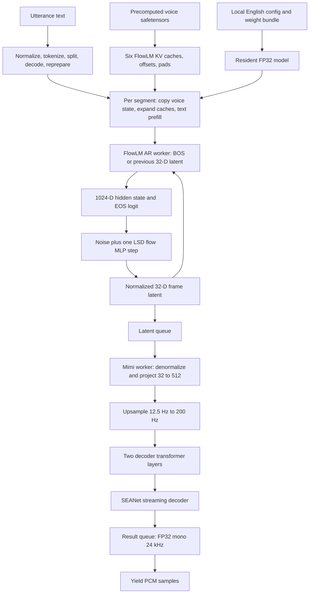

# Pocket TTS 3.3.0 pipeline for Out Loud

> Historical upstream investigation and native-port proposal, not a current production architecture or runtime dependency guide. See [ARCHITECTURE.md](ARCHITECTURE.md) for the implemented engine; original source observations and proposed work below are preserved.

This is an inspection of the installed implementation used by
[the unchanged oracle](../reference/pocket_oracle.py), before any native inference
implementation or backend decision. It describes English, CPU, batch 1,
temperature 0.3, one LSD decode step, no quantization, and precomputed voices.

Evidence labels used throughout:

- **S**: source-verified in the installed package/configuration or local PyTorch headers.
- **R**: runtime-observed with offline, read-only probes on this environment.
- **I**: architectural inference or a proposal for the native port.
- **UNVERIFIED**: not established by this investigation.

Source paths below are relative to `.venv/Lib/site-packages/pocket_tts/`, unless
stated otherwise. Function names are included so references survive line shifts.
No package files, voice/model assets, or tracked oracle files were changed.
No network access, package installation, native code, or backend selection was needed.

## 1. Verified environment and reference

**R**: Python 3.12.10; `pocket-tts` 3.3.0; PyTorch 2.14.1+cpu;
`tokenizers` 0.23.2. Before Pocket import, intra-op/inter-op threads are 12/12;
after import, 1/12. **S**: `models/tts_model.py` sets `torch.set_num_threads(1)`.
**R**: MKLDNN is enabled; all loaded model state tensors and synthesis activations
are float32 on CPU. Mimi is in eval mode; TTSModel/FlowLM retain `training=True`.
**S**: the executed modules contain no active dropout (attention uses
`dropout_p=0.0`), so that mode difference adds no training randomness here.

| Asset | Revision | SHA-256 |
|---|---|---|
| `kyutai/pocket-tts`, `languages/english/model.safetensors` | `983151f13aaeab1b13c1e5e3c2c383d49a9edf3f` | `fb0dc01b0d4d2e1c905b7a3e0676e3d9c96d5ae460e24e3ab94981805babf997` |
| `kyutai/pocket-tts-without-voice-cloning`, `languages/english/tokenizer.json` | `00eac05ed3d16bdc3f6b5d598874019c34a89214` | `f498428e1eafee50492f7be13dc9bfafcfc12e508cd0eb1b01c92ecd5d8c6687` |
| `voices/gnome_male.safetensors` | Local precomputed state | `2118ea60dfe87bd515b27e051e1d677a7fe15663875740599147bde37a9c4cea` |

**S/R**: `config/english.yaml` pins those two remote revisions. The probes
resolved existing local cache files with `HF_HUB_OFFLINE=1` and
`hf_hub_download(..., local_files_only=True)`, and recomputed all three hashes.
No fallback model was used. Cache locations on this machine:

```text
C:/Users/rosko/.cache/huggingface/hub/models--kyutai--pocket-tts/snapshots/983151f13aaeab1b13c1e5e3c2c383d49a9edf3f/languages/english/model.safetensors
C:/Users/rosko/.cache/huggingface/hub/models--kyutai--pocket-tts-without-voice-cloning/snapshots/00eac05ed3d16bdc3f6b5d598874019c34a89214/languages/english/tokenizer.json
```

The recorded oracle is seed 73, 170 chunks, 326400 samples, 13.600 seconds,
24 kHz mono, float32 little-endian hash
`e4e1004ffda5a83b205a6d131d34209a88596012b249657702657c924ec529b9`.
Historical warm first PCM was about 90.4 ms; generation 3.523 s, 3.861x realtime
([existing reference](../reference/UPSTREAM.md)). These timings are not a contract.

**Validation finding (R):** the required unmodified oracle invocation during this
investigation did **not** reproduce that hash. Both runs had 326400 samples and
150 chunks; cold hash was
`d144539d769b44d3faa6958c85f6b4d12741af12a2ba1f851e34cdc8335c6a9f`,
warm hash was
`8a0947f96e8bd2c496777b309dc695f3ea30dcc56944932ee2b4eb2f2dd19e5a`.
Cold/warm bit equality failed. Cold/warm first PCM was 111.9/106.6 ms,
generation 4.465/4.461 s. A separate read-only inspection run with the model
instance's `max_decoder_frames_per_call=1` produced **exactly the recorded hash**,
170 chunks and 326400 samples. The tracked oracle and recorded baseline remain
unchanged. Default queue coalescing is a reproducibility hazard; see section 8.
The ignored `generated/pocket_oracle_gnome.*` artifacts now reflect the required
unmodified invocation, including its failed match, rather than a replacement baseline.

## 2. High-level pipeline



**S**: after synchronous text prefill, the autoregressive worker and decoder
worker run concurrently; the caller drains the result queue. An audio latent
represents 80 ms, but a yielded chunk can contain multiple such frames.

## 3. Detailed stages and computations

### Model load (once per resident model)

**S**: `models/tts_model.py:TTSModel.load_model` (line 285) calls
`utils/config.py:load_config`, `_from_pydantic_config_with_weights` (line 210),
`FlowLMModel.from_pydantic_config`, and `models/mimi.py:build_mimi`.
`utils/utils.py:download_if_necessary` resolves pinned cached HF files for the
oracle; a native loader needs local asset paths only. The bundle is loaded by
`safetensors.torch.load_file` and `load_state_dict(..., strict=True)` with no
separate weight-key remapping on this path. Mimi is put in eval mode;
`stamp_state_names` assigns state lookup names to every StatefulModule.

**R/S**: all 214 stored tensors are BF16; copying into the constructed float32
parameters/buffers widens the stored values to FP32. Do not regenerate
time-frequency buffers at higher precision and silently replace their loaded,
BF16-rounded values. Quantization is bypassed. Model weights and tokenizer
are constant across voices and utterances.

### Voice load (once per selected voice)

**S**: `TTSModel.get_state_for_audio_prompt` (line 914) detects the
`.safetensors` suffix, resolves the local string to a Path, then returns
`models/model_state.py:_import_model_state` directly. It neither reads audio
nor runs Mimi encoding nor samples a latent for this path. See section 6.

### Utterance text setup and per-segment reset

**S**: `TTSModel.generate_audio_stream` (line 635) calls
`models/text_chunking.py:split_into_best_sentences`, using `max_tokens=50`.
It prepares each returned segment again with `prepare_text_prompt` and selects
`frames_after_eos = word_count_guess + 2`, because the English config's
recommended override is None. Each of the oracle's segments has more than four
words, hence an effective tail of 3.

`_generate_audio_stream_short_text` (line 741) deep-copies the supplied
ModelState with `copy_state=True`, calls `LUTConditioner.prepare`, computes the
maximum frame count, starts the decoder thread, and invokes `_generate`
(line 821). `_generate` expands voice caches to
`voice_offset + token_count + max_gen_len`, then synchronously prefills text.
The voice copy is made **for each segment**, not just once per whole utterance.

### FlowLM text prefill and frame backbone

**S**: `TTSModel._run_flow_lm_and_increment_step` (line 390) supplies empty
inputs for absent text, audio latents, and audio conditioning. `_run_flow_lm`
(line 421) embeds text through
`modules/text_conditioner.py:LUTConditioner.forward`, concatenates any
audio conditioning, and calls `FlowLMModel._sample_next_latent`/`forward`.
The wrapper increments all FlowLM attention offsets **after** the forward by
the total number of text, latent and audio-conditioning positions consumed.

`models/flow_lm.py:FlowLMModel.forward` (line 121) replaces each NaN latent
element with the corresponding learned `bos_emb` value, projects latents
32 -> 1024 with a bias-free linear, and calls `backbone` (line 167).
The sequence supplied to the transformer is `[text/audio conditioning; latent
input embeddings]`. Six layers produce a hidden sequence; final LayerNorm
uses epsilon 1e-5, then only the last position conditions EOS and flow sampling.

Text prefill has latent input shape `[1,0,32]`. The slice
`transformer_out[:, -sequence.shape[1]:]` becomes `[:,0:]`, so the text hidden
sequence is retained, and its last position is sampled. That sampled latent
and EOS result are discarded by `_generate`, **but the noise draw and flow
MLP calculation still happen**. Its KV-cache updates and offset increment are used.

**S**: `modules/transformer.py:StreamingTransformerLayer` performs pre-norm
attention with residual addition, then pre-norm FFN with residual addition.
FlowLM has 16 heads, head dimension 64, FFN width 4096, no layer scales,
and tanh-approximate GELU. `StreamingMultiheadAttention.forward` in
`modules/attention.py` uses packed bias-free Q/K/V projection, RoPE on Q and K,
post-RoPE K plus V cache writes, causal scaled dot-product attention with
scale 1/sqrt(64), dropout 0, and a bias-free output projection.
FlowLM attention has no finite context cutoff.

`modules/rope.py:apply_rope` pairs adjacent coordinates as real/imaginary;
for pair index d it uses `exp(d * (-log(10000)*2/64))`, sin/cos of absolute
position plus offset, all computed in float32. Cache offsets include all
112 voice positions and text positions, not just generated frames.

### Flow sampler (text prefill and every generated candidate)

**S**: `FlowLMModel.forward` calculates `out_eos(hidden) > -4.0` directly;
there is no sigmoid, EOS token sampling, or softmax token decoder.
It initializes contiguous float32 noise `[1,32]` with
`torch.nn.init.normal_(mean=0, std=sqrt(0.3))`. Noise clamp is None.
`flow_type` defaults to `lsd`; `lsd_decode` (line 20) with one step supplies
`s=0`, `t=1` of shape `[1,1]` and returns `noise + flow_net(hidden,s,t,noise)`.

**S**: `modules/mlp.py:SimpleMLPAdaLN.forward` projects the noise 32 -> 512;
projects condition 1024 -> 512; embeds each of s/t using 256 sin/cos features
(128 frequencies), Linear -> SiLU -> Linear -> RMSNorm; and adds the average
of those two time embeddings to the projected condition. Six residual blocks
compute shift, scale and gate from the condition via SiLU -> Linear;
apply custom LayerNorm to x, modulate `x*(1+scale)+shift`, run
Linear -> SiLU -> Linear, and add the gated update. The final layer normalizes,
modulates with a shift/scale pair, then projects 512 -> 32.

Parity detail: the module named `RMSNorm` uses **`x.var(...)` with default
sample-variance correction**, not mean-square RMS. Its epsilon is 1e-5.
The custom LayerNorm uses population variance (`unbiased=False`), epsilon 1e-6.
Preserve these actual formulas, operation order, and loaded frequency values.
The sampler has no persistent frame cache; its RNG is persistent outside ModelState.

### Latent-to-PCM decoding

**S**: `TTSModel._decode_audio_worker` (line 503) initializes a fresh Mimi
ModelState per text segment, drains available latent frames without waiting
for more after the first, and denormalizes:
`z = normalized_latents * flow_lm.emb_std + flow_lm.emb_mean`.
`emb_std/emb_mean` are constant learned normalization buffers `[32]`.

`models/mimi.py:MimiModel.decode_from_latent` (line 92) transposes `[1,F,32]`
to `[1,32,F]`. `modules/dummy_quantizer.py:DummyQuantizer` is only a bias-free
1x1 Conv1d projection to `[1,512,F]`; it performs **no codebook quantization**.
`_to_encoder_framerate` invokes `modules/resample.py:ConvTrUpsample1d`:
depthwise transposed convolution, 512 groups, kernel 32, stride 16, no bias.
Streaming overlap handling yields exactly `[1,512,16F]`.

`modules/transformer.py:ProjectedTransformer` transposes to `[1,16F,512]`;
input/output projections are identities at these dimensions. Two causal
decoder layers have 8 heads of 64, FFN width 2048, LayerNorm epsilon 1e-5,
tanh-approximate GELU and learned per-channel layer scales. Context mask
requires `0 <= query_position-key_position < 250`. K/V storage is still
a **linear cache**, not a ring buffer; old positions are masked rather than evicted.

`modules/seanet.py:SEANetDecoder.forward` starts with causal Conv1d 512 -> 512,
kernel 7; then three ELU/transposed-conv/residual groups with upsampling
ratios 6, 5, 4 and channels 512 -> 256 -> 128 -> 64; and ends with
ELU -> causal Conv1d 64 -> 1, kernel 3. Each residual block has ELU,
kernel-3 conv to half-width, ELU, kernel-1 conv back, plus identity addition.
There is no final tanh, clamp, resampling, crossfade or silence insertion.

Streaming convolutions in `modules/conv.py` prepend saved input history.
Transposed convolutions add the saved output overlap to the head, save the
tail **with bias subtracted where bias exists**, and remove that tail from
this call's output. These histories survive every frame within a segment.
At the segment end no overlap flush is performed.

**S/R**: one latent produces `[1,1,1920]` float32 audio, i.e. 80 ms at 24 kHz;
F latents produce `[1,1,1920F]`. Mimi attention offsets advance by `16F`
after decode. The stream yields `audio_chunk[0,0]`, shape `[1920F]`.
The oracle flattens contiguous float32 chunks and concatenates them in order.
Its float32 comparison serializes little-endian samples without clipping.
Its listening-only WAV clamps [-1,1], multiplies by 32767, rounds, and casts
to little-endian int16. PCM16 is outside the model computation.

## 4. Exact tensor and persistent-state tables

Shapes use batch 1; N=text tokens in a segment, F=queued latent frames decoded
in one call, L=allocated sequence capacity. All float entries are float32 at
runtime. **S** establishes variable shapes; **R** observed the concrete oracle
shapes and first-frame decoder progression below.

| Tensor / stage | Input -> output shape | Dtype | Lifetime / meaning |
|---|---|---|---|
| Tokenizer / LUT prepare | string -> `[1,N]` | int64 | Per segment; IDs 0..3999 |
| Text embedding | `[1,N]` -> `[1,N,1024]` | float32 output | Constant `[4001,1024]` table; per-segment activations |
| Empty text/audio conditioning on a frame | `[1,0]`, `[1,0,1024]` | int64, float32 | Per call; no new text/voice embedding |
| Prefill latent input | `[1,0,32]` -> `[1,0,1024]` | float32 | No audio input positions |
| First AR input / learned BOS | `[1,1,32]` NaNs -> broadcast learned `[32]` | float32 | Per segment, first frame only |
| Later AR input | previous normalized `[1,1,32]` -> `[1,1,1024]` | float32 | Per frame; do not denormalize before feedback |
| Backbone hidden | prefill `[1,N,1024]` or frame `[1,1,1024]` -> selected `[1,1024]` | float32 | Per call |
| FlowLM packed QKV | `[1,T,1024]` -> `[1,T,3,16,64]` | float32 | T=N on prefill, 1 on frames |
| Mimi packed QKV | `[1,16F,512]` -> `[1,16F,3,8,64]` | float32 | Per decode call |
| EOS head | `[1,1024]` -> logit `[1,1]`, comparison `[1,1]` | float32, bool | Per candidate; threshold -4.0 |
| Noise / sampler state | `[1,32]` | float32 | New draw every FlowLM forward, including prefill and final discarded candidate |
| LSD times | s/t each `[1,1]` -> features `[1,256]` -> embedding `[1,512]` | float32 | s=0/t=1 constant at one step; no cache upstream |
| Flow MLP | c=`[1,1024]`, x=`[1,32]` -> internal `[1,512]`, velocity `[1,32]` | float32 | Stateless conditioned frame computation |
| Sampler output | `[1,32]` -> wrapper `[1,1,32]` | float32 | Normalized latent queued/feedback |
| Decoder denormalization | `[1,F,32]` -> `[1,F,32]` | float32 | Constant mean/std `[32]`; per call |
| DummyQuantizer | `[1,32,F]` -> `[1,512,F]` | float32 | Learned projection, not discrete codes |
| Mimi upsample | `[1,512,F]` -> `[1,512,16F]` | float32 | 12.5 Hz -> 200 Hz |
| Mimi decoder transformer | `[1,512,16F]` -> same | float32 | Two cached layers |
| SEANet initial conv | `[1,512,16F]` -> same | float32 | Causal history |
| SEANet group 1 | `[1,512,16F]` -> `[1,256,96F]` | float32 | ratio 6; residual preserves shape |
| SEANet group 2 | `[1,256,96F]` -> `[1,128,480F]` | float32 | ratio 5; residual preserves shape |
| SEANet group 3 | `[1,128,480F]` -> `[1,64,1920F]` | float32 | ratio 4; residual preserves shape |
| Final conv / PCM yield | `[1,64,1920F]` -> `[1,1,1920F]` -> `[1920F]` | float32 | Mono PCM; no model-side clipping |

**S/R**: `ModelState = dict[module_name][tensor_name]`; there is no opaque
transformer state object. `init_states` initializes every StatefulModule;
`increment_steps` calls every such module's increment function. Only attention
offsets need incrementing; convolution state changes inside its forward.

| State | Exact shape / dtype | Initial value and update |
|---|---|---|
| FlowLM `transformer.layers.i.self_attn/cache`, i=0..5 | `[2,1,L,16,64]` float32 | Voice prefix length 112; K (index 0, already RoPE applied) and V (index 1). Expanded unused capacity is NaN |
| FlowLM `offset`, each layer | `[1]` int64 | Voice value 112; +N after text, +1 after each candidate |
| FlowLM `pad`, each layer | `[1]` int64 | Voice value 0; only nonzero in upstream padded batches |
| Mimi `decoder_transformer.transformer.layers.i.self_attn/cache`, i=0..1 | `[2,1,L,8,64]` float32 | NaN-filled fresh capacity, L=`16*max_gen_len`; writes on decode |
| Mimi attention `offset`, `pad` | each `[1]` int64 | Fresh zeros; offset +16F, pad remains zero |
| Conv1d `previous` | `[1,Cin,effective_kernel-stride]` float32 | Zero history, replaced by latest input tail |
| Conv1d `first` | `[1]` bool | True initially; only replicate-padding convolutions consult/update it |
| ConvTranspose1d `partial` | `[1,Cout,kernel-stride]` float32 | Zero initially; saves overlap tail for next call |
| AR loop | previous `[1,1,32]`, Python EOS index or None, frame index | NaN BOS, then normalized previous latent; EOS index latches once |
| RNG | PyTorch default CPU generator, separate from ModelState | Reset once before the whole utterance, not each segment |

Decoder-side convolution state names and exact shapes (**S/R**, excluding
unused encoder state):

| Module (relative to `mimi`) | Saved tensor | Shape |
|---|---|---|
| `upsample.convtr` | `partial` | `[1,512,16]` |
| `decoder.model.0` | `previous` | `[1,512,6]` |
| `decoder.model.2` | `partial` | `[1,256,6]` |
| `decoder.model.3.block.1` | `previous` | `[1,256,2]` |
| `decoder.model.3.block.3` | `previous` | `[1,128,0]` |
| `decoder.model.5` | `partial` | `[1,128,5]` |
| `decoder.model.6.block.1` | `previous` | `[1,128,2]` |
| `decoder.model.6.block.3` | `previous` | `[1,64,0]` |
| `decoder.model.8` | `partial` | `[1,64,4]` |
| `decoder.model.9.block.1` | `previous` | `[1,64,2]` |
| `decoder.model.9.block.3` | `previous` | `[1,32,0]` |
| `decoder.model.11` | `previous` | `[1,64,2]` |

Every `previous` row also has `first: bool[1]`, although constant-padding
decoder convolutions do not use that flag. Empty kernel-1 histories need no
sample storage. Upstream initializes additional encoder/encoder-transformer/
downsample state in `init_states(self.mimi,...)`, and increments even unused
encoder attention offsets; those states do not participate in decoding.

`copy_state=True` copies **all tensors in the supplied voice ModelState**:
six K/V caches, offsets, pads, and any additional entries a caller supplied.
It copies no model weights, tokenizer, RNG, queues, or Mimi decoder state.
Those decoder states are independently allocated fresh per segment.

## 5. Oracle text normalization, tokenization and exact IDs

Oracle text (**R**, unchanged by preparation):

> The watch captain needs your help before the next caravan arrives. Follow the river to the abandoned tower, speak with the scout waiting at its gate, and bring his report back to the village. Keep your lantern burning, for the path is narrow.

**S**: `prepare_text_prompt` strips edges; with this config replaces newline
and carriage return by space and performs one `.replace("  "," ")` pass;
capitalizes the first character when needed; ensures terminal punctuation.
It leaves semicolons unchanged, applies no character mapping, and adds no
short-input space padding for this English config. General punctuation logic
preserves terminal `.`, `!`, `?`, or U+2026 (ellipsis) behind closing punctuation,
replaces trailing weak punctuation with a period, otherwise appends a period.
Port the actual `text_chunking.py` rules, including Unicode case/whitespace
semantics, rather than adding a new normalization policy.

**S/R**: active implementation is `modules/text_conditioner.py:JsonTokenizer`,
backed by `tokenizers.Tokenizer.from_file`, **not SentencePiece execution**.
The tokenizer JSON has a Unigram model, 4000 vocabulary entries with scores,
`unk_id=0`, byte fallback enabled, normalizer `Prepend("\u2581")`, Metaspace
pre-tokenizer with replacement U+2581, prepend scheme `always`, split=true.
Decoder sequence is Metaspace -> ByteFallback -> Fuse. There is no
post-processor, truncation or padding. No NFKC/lowercase normalizer is present.

Added special tokens: 0=`<unk>`, 1=`<s>`, 2=`</s>`, 3=`<pad>`;
all are marked special, normalized=false, with no stripping/single-word flags.
**No BOS or EOS IDs are automatically inserted** in this text path. Decode
uses the library's default special-token skipping. LUT has an extra row 4000
for padding by construction, separate from JSON `<pad>` ID 3; neither padding
kind is used in oracle synthesis. Vocabulary entries 4..259 represent the 256
byte fallback tokens. Audio BOS and voice BOS are learned vectors, not IDs.

**R**: full normalized text token IDs (75):

```text
[364, 626, 331, 3492, 1634, 312, 525, 260, 531, 265, 598, 722, 362, 1834,
 260, 486, 582, 314, 261, 263, 496, 574, 1851, 265, 3250, 266, 265, 267,
 2065, 307, 449, 278, 266, 479, 295, 262, 931, 291, 265, 1050, 629, 934,
 273, 309, 275, 261, 3487, 262, 269, 750, 376, 260, 1596, 382, 266, 265,
 3034, 590, 263, 3602, 312, 697, 2041, 306, 1862, 273, 262, 284, 265,
 1871, 277, 913, 334, 1141, 263]
```

The model never receives that full list at once. **S/R**: the splitter obtains
boundary IDs by encoding `.!...?`: `[260,263,682,799,292]`, discarding initial
260. It groups consecutive boundary tokens, skips decimal periods, decodes
token segments, optionally subdivides oversized sentences at comma/semicolon/
colon IDs (encoding `,;:` gives `[260,262,1230,3244]`, again discarding 260),
and greedily combines segments up to 50 counted tokens. This limit is soft:
an unsplittable oversized segment can exceed it and triggers a warning.
Each returned string is stripped, prepared and **retokenized** for generation.

Actual generation inputs (**R**):

```text
Segment 1 (20): The watch captain needs your help before the next caravan arrives.
[364, 626, 331, 3492, 1634, 312, 525, 260, 531, 265, 598, 722, 362, 1834,
 260, 486, 582, 314, 261, 263]

Segment 2 (39): Follow the river to the abandoned tower, speak with the scout waiting at its gate, and bring his report back to the village.
[496, 574, 1851, 265, 3250, 266, 265, 267, 2065, 307, 449, 278, 266, 479,
 295, 262, 931, 291, 265, 1050, 629, 934, 273, 309, 275, 261, 3487, 262,
 269, 750, 376, 260, 1596, 382, 266, 265, 3034, 590, 263]

Segment 3 (16): Keep your lantern burning, for the path is narrow.
[3602, 312, 697, 2041, 306, 1862, 273, 262, 284, 265, 1871, 277, 913, 334,
 1141, 263]
```

**I**: native tokenization needs the pinned JSON vocabulary and scores, special
tokens, byte fallback, Unigram segmentation and tie-breaking, exact pre/decoder
behavior, plus the upstream text preparation and token-based splitting rules.
Retain the complete tokenizer asset locally; 75 IDs alone are not sufficient.
**UNVERIFIED**: native tokenizer/library selection and parity on arbitrary
Unicode text, abbreviations and pathological long sentences. No implementation
choice is made here.

## 6. Voice safetensors structure and future .olv candidates

**R**: metadata is null; exactly 18 tensors. All six caches are finite.
The complete names/shapes/dtypes are:

| Tensor name | Shape | Stored/runtime dtype | Value for scalars |
|---|---|---|---|
| `transformer.layers.0.self_attn/cache` | `[2,1,112,16,64]` | F32 / float32 | K/V prefix |
| `transformer.layers.0.self_attn/offset` | `[1]` | I64 / int64 | 112 |
| `transformer.layers.0.self_attn/pad` | `[1]` | I64 / int64 | 0 |
| `transformer.layers.1.self_attn/cache` | `[2,1,112,16,64]` | F32 / float32 | K/V prefix |
| `transformer.layers.1.self_attn/offset` | `[1]` | I64 / int64 | 112 |
| `transformer.layers.1.self_attn/pad` | `[1]` | I64 / int64 | 0 |
| `transformer.layers.2.self_attn/cache` | `[2,1,112,16,64]` | F32 / float32 | K/V prefix |
| `transformer.layers.2.self_attn/offset` | `[1]` | I64 / int64 | 112 |
| `transformer.layers.2.self_attn/pad` | `[1]` | I64 / int64 | 0 |
| `transformer.layers.3.self_attn/cache` | `[2,1,112,16,64]` | F32 / float32 | K/V prefix |
| `transformer.layers.3.self_attn/offset` | `[1]` | I64 / int64 | 112 |
| `transformer.layers.3.self_attn/pad` | `[1]` | I64 / int64 | 0 |
| `transformer.layers.4.self_attn/cache` | `[2,1,112,16,64]` | F32 / float32 | K/V prefix |
| `transformer.layers.4.self_attn/offset` | `[1]` | I64 / int64 | 112 |
| `transformer.layers.4.self_attn/pad` | `[1]` | I64 / int64 | 0 |
| `transformer.layers.5.self_attn/cache` | `[2,1,112,16,64]` | F32 / float32 | K/V prefix |
| `transformer.layers.5.self_attn/offset` | `[1]` | I64 / int64 | 112 |
| `transformer.layers.5.self_attn/pad` | `[1]` | I64 / int64 | 0 |

**S**: `_import_model_state` splits each name on `/`, rebuilding the nested
dict and moving tensors to the model device. It also supports old
`current_end` tensors by turning their shape[0] into an int64 `offset[1]`;
this compatibility branch is unused by this voice. There are no raw samples,
speaker embeddings, Mimi histories, or RNG states in the file.

**S**: exported voice states normally originate from Mimi `encode_to_latent`
(32-D latents), `F.linear(latents, speaker_proj_weight)` to 1024-D conditioning,
and, for this config, a learned `[1,1,1024]` `bos_before_voice` prefix, followed
by FlowLM prefill. **UNVERIFIED**: original recording, exact export invocation,
and whether every tensor in this particular file was generated with that
process; the file has no provenance metadata. The 112-position cache alone
does not prove source audio duration.

**S/I**: normal synthesis needs each layer's valid K/V prefix and absolute
offset. This voice has identical offsets, so a future format could represent
112 once and assert layer consistency. Zero `pad` is functionally redundant
for batch 1 without padding; native code can establish it as an invariant.
K already contains RoPE; do not rotate the imported keys again.

**I**: .olv candidates are FP32 K/V data, prefix/offset and dimensions,
model compatibility identity (model hash/revision), format version, dtype/
endianness/layout, integrity check and voice identity. Raw audio and decoder
state need not be included. These are requirements, not a file specification;
no .olv file or format is created. Prefix tensors total 5,505,024 bytes;
12 int64 scalar tensors add 96 bytes, excluding safetensors header.

## 7. Streaming lifecycle, EOS and cancellation

**S**: before first PCM the caller normalizes and splits all utterance text,
copies/expands the first voice state, tokenizes/embeds its text, initializes
Mimi state and queues, executes text prefill (including discarded sample),
then starts the AR worker. That worker computes a BOS-conditioned candidate,
queues it, and Mimi denormalizes/decodes it. Subsequent frames repeat the
backbone, EOS head, noise + flow sampler, enqueue, Mimi decode, state updates
and yield. Text processing/prefill and state initialization recur per segment.

`_estimate_max_gen_len` (line 1040) is
`ceil((token_count/3.0 + 2.0) * 12.5)`; it is a safety bound, not the expected
audio length. `_autoregressive_generation` (line 858) tests cancellation
before each candidate, latches the first positive EOS test at zero-based
`generation_step >= 6`, and breaks when
`generation_step >= eos_step + frames_after_eos`. This break happens **after**
computing/sampling that candidate and advancing the cache, **before** queueing
it. Thus the final discarded candidate still consumes RNG. EOS may latch
even if subsequent logits return below threshold.

**R**: inspection observed the following with seed 73 (both instrumented runs
had the same FlowLM EOS logits and call counts):

| Segment | N | Max candidates | FlowLM cache capacity | Mimi cache capacity (per layer) | First accepted EOS index | Emitted frames | Candidate calls including final discarded | Final FlowLM offset |
|---|---|---|---|---|---|---|---|---|
| 1 | 20 | 109 | 241 | 1744 | 43 | 46 | 47 | 179 |
| 2 | 39 | 188 | 339 | 3008 | 81 | 84 | 85 | 236 |
| 3 | 16 | 92 | 220 | 1472 | 37 | 40 | 41 | 169 |

There is also one text-prefill call per segment: 176 FlowLM sampling calls
overall, versus 170 emitted latents. Output lengths by segment are 88320,
161280 and 76800 samples (3.680, 6.720 and 3.200 seconds).
Mimi decoder attention final offsets are 736, 1344 and 640 respectively
(**S**, derived from 16 steps per emitted latent).

The decoder consumes all queued frames currently available. Default
`max_decoder_frames_per_call=0` imposes no per-call maximum; 1 forces one
frame. Coalescing is based on scheduling, not text or EOS. The first frame
does not wait for a batch to fill. Finishing puts a None latent sentinel;
the decoder puts a `done` result after queued work. There is no final
convolution-overlap flush. Segments' PCM is simply concatenated with no
teacher forcing from the previous segment, crossfade, inserted pause, or
retained Mimi history when `copy_state=True`.

**S**: `stop: threading.Event` stops new candidates and later segments;
already queued frames can still be decoded/yielded. Decode errors and AR
errors reach the result queue. The caller explicitly joins the decoder;
the AR thread is daemonized and has no explicit join here. An orderly stream
ends after it has sent the sentinel. Upstream does not promise simultaneous
utterances on the same model; use one active utterance per native core.

## 8. RNG and determinism

**S**: `reference/pocket_oracle.py:reset_rng` seeds Python random, NumPy and
PyTorch immediately before each complete generation. Only PyTorch randomness
is used on this inspected synthesis path. Loading a precomputed voice has no
random operation. Model construction uses random initialization for learned
`bos_emb`, `bos_before_voice`, Embedding, Linear and convolution parameters,
but strict weight loading overwrites them, and the oracle reseeds afterwards.

During synthesis the only random operation is the unclamped `normal_` on
`[1,32]`, once per `FlowLMModel.forward`: three text-prefill draws, 170 emitted
candidate draws and three final discarded candidate draws. Do not omit those
six discarded draws, reseed between segments, denormalize AR feedback, or
share an RNG with unrelated random work. No Mimi sampling/dropout occurs.
The configured truncated-normal branch exists but is not taken; OT decoding
and multiple LSD steps are also outside this path.

**S** (local PyTorch headers, under `.venv/Lib/site-packages/torch/include/`):
`ATen/CPUGeneratorImpl.h` holds an `at::mt19937` engine plus optional cached
float/double normal samples. `ATen/core/MT19937RNGEngine.h` defines the engine.
`ATen/native/cpu/DistributionTemplates.h:normal_kernel/normal_fill` selects
the contiguous, >=16-element path for these 32-float draws; it generates
uniforms and applies Box-Muller in 16-element blocks (pairs from positions
j and j+8). The float AVX2 specialization uses vector log/sincos and FMA.
A scalar alternative exists. This is not interchangeable with
`std::normal_distribution` solely because both have seed 73.

**I**: exact native RNG parity requires the seed-to-engine state mapping,
uniform conversion, consumed draw order, Box-Muller block ordering and
matching numerical approximations, as well as preservation of any relevant
generator state. A first port can accept captured oracle noise arrays to
isolate arithmetic parity from RNG implementation. **UNVERIFIED**: actual
compiled normal-kernel dispatch on this CPU and cross-platform bit equality;
the available headers expose alternatives but this step did not trace the
compiled kernel. Native RNG is not implemented or proven equivalent.

The historical same-seed equality is explained by resetting the same RNG,
copying an unchanged voice prefix, resetting Mimi state, deterministic
arithmetic, and matching decode-call grouping. **R**: it is **not an unconditional
property of the current default stream**. An instrumented default run yielded
141 chunks and hash
`c1abaf75025a3bc8076508648bdd7c60c26d2827935419f26816b6e01d89696a`;
the unmodified oracle cold/warm run also differed (section 1). Setting only
the diagnostic instance's decoder limit to 1, with the same inspection hooks,
recovered the historical exact hash and 170 chunks.

**I supported by S/R**: scheduler-dependent multi-frame Mimi calls change
floating-point computation grouping/kernel shapes, explaining this hazard.
Identical mathematical output length is insufficient for bit equality.
**UNVERIFIED**: which individual Mimi kernel first diverges when frames are
coalesced. Do not modify or loosen the recorded oracle to conceal this.
For future checkpoint work, explicitly record/control decoder-call grouping
alongside seed and tensors; propose a one-frame diagnostic harness separately
from the unchanged oracle. The snapshot retains the original expected hash.

## 9. Model weights and component organization

**R**: model safetensors metadata is null, namespace is `flow_lm.*` and
`mimi.*`, 214 tensors, all BF16, 109,502,146 stored elements. Runtime values
are FP32 after loading (438,008,584 tensor payload bytes before other allocations).
Counts include buffers, not just trainable parameters.

| Weight namespace | Tensors | Elements | Synthesis role |
|---|---|---|---|
| `flow_lm.conditioner.*` | 1 | 4,097,024 | Text embedding `[4001,1024]` |
| `flow_lm.transformer.*` | 48 | 75,522,048 | Six backbone layers |
| `flow_lm.input_linear.*` | 1 | 32,768 | Latent projection `[1024,32]` |
| `flow_lm.out_norm.*` | 2 | 2,048 | Final backbone LayerNorm |
| `flow_lm.out_eos.*` | 2 | 1,025 | EOS weight `[1,1024]` and bias `[1]` |
| `flow_lm.bos_emb` | 1 | 32 | Audio BOS |
| `flow_lm.emb_mean`, `flow_lm.emb_std` | 2 | 64 | Latent denormalization |
| `flow_lm.flow_net.*` | 68 | 9,759,008 | One-step flow sampler MLP |
| `flow_lm.bos_before_voice` | 1 | 1,024 | Voice export only, `[1,1,1024]` |
| `flow_lm.speaker_proj_weight` | 1 | 32,768 | Voice export only, `[1024,32]` |
| `mimi.quantizer.*` | 1 | 16,384 | Output projection `[512,32,1]` |
| `mimi.upsample.*` | 1 | 16,384 | Depthwise transposed conv weight `[512,1,32]` |
| `mimi.decoder_transformer.*` | 20 | 6,297,600 | Two streaming decoder layers |
| `mimi.decoder.*` | 22 | 3,974,945 | SEANet decoder |
| `mimi.encoder.*` | 22 | 2,927,136 | WAV prompt encoding only |
| `mimi.encoder_transformer.*` | 20 | 6,297,600 | WAV prompt encoding only |
| `mimi.downsample.*` | 1 | 524,288 | Voice-encoding projection to 32-D |

**S/R**: backbone keys include
`transformer.layers.i.self_attn.in_proj.weight` `[3072,1024]`,
`out_proj.weight` `[1024,1024]`, `linear1.weight` `[4096,1024]`,
`linear2.weight` `[1024,4096]`, and two norms' scale/bias. Sampler keys include
`time_embed.{0,1}.freqs` `[128]`, time MLP weights, `cond_embed`, `input_proj`,
`res_blocks.0..5` norm/MLP/adaLN parameters and `final_layer`.
Mimi transformer keys additionally include the two learned layer scales
per layer. No codebooks are represented in DummyQuantizer.

**I**: a local native loader could omit the five export-only namespaces/keys
above (45 tensors, 9,782,816 elements), leaving 169 synthesis tensors,
99,719,330 elements. This is a dependency analysis, not an exported reduced
weight file. Do not remove the DummyQuantizer output projection despite
omitting quantization infrastructure.

## 10. Likely performance-critical path

No timing hooks, broad benchmark matrices or source replacements were added.
The probes used ordinary forward hooks to inspect shapes/EOS only; their
performance is not a baseline. The existing historical timings remain in
UPSTREAM.md; section 1 reports the required run only.

**I based on S/R**:

- Text/prompt setup performs string/tokenizer encode/decode/reencode work,
  prefix copying, expanded cache allocation and a multi-token backbone prefill.
  Prefill also runs a discarded sampler, so it is not just token embedding.
- FlowLM likely accounts for a large recurring group: six 1024-wide
  transformer layers with 4096-wide FFNs, dense QKV/output projections and
  attention over an increasing prefix, once per candidate.
- Each candidate additionally runs two timestep MLPs and six 512-wide
  adaLN residual blocks. At one decode step this cost occurs once, not an
  iterative multi-step diffusion loop.
- Mimi expands one latent to 16 200-Hz positions, runs two 512-wide
  transformer layers, then convolutions up to 1920 samples. It has its own
  significant recurring computation and overlaps FlowLM on a worker thread.
- Per-segment copying of the roughly 5.5 MB voice prefix and larger
  NaN-filled caches, repeated module traversal for offset updates, queues,
  scalar `.item()` accesses and thread creation add overhead. Upstream also
  allocates unused Mimi encoder state and retains decoded chunks in a local list.

**UNVERIFIED**: isolated CPU-time fractions and the slowest individual kernel.
Weight counts and source structure do not establish a timing percentage.
No optimization or scheduling redesign is performed in this step.

## 11. MUST HAVE FOR RUNTIME and logical core API

**I grounded in the executed dependency graph**: the minimal Out Loud runtime
needs local compatible weights/tokenizer/config constants, FP32 CPU kernels
for the listed text/backbone/sampler/decoder computations, loaded per-voice
prefix caches, independent per-segment mutable FlowLM and Mimi state, exact
text preparation/chunking, stochastic latent draws, EOS/cap/tail control,
streaming output, cancellation and orderly worker/state lifetime handling.
Keep the model and selected immutable voice prefix resident; reset utterance
state without unloading them. Batch and channel count can be fixed to 1.

Proposed boundary, **documentation only**:

```text
OutLoudPocketCore
    load_model(local_model, local_tokenizer, compatibility_metadata)
    load_voice(local_olv)                   // validate model compatibility
    start_utterance(utf8_text, options)     // one active utterance; seed optional
    read_chunk() -> float32 mono samples | end | error
    cancel_utterance()                      // stop work, release utterance state
```

**I**: model/voice replacement occurs when idle. Options can initially be
fixed production defaults, with a seed and decoder-grouping control in test
instrumentation. Expose sample rate 24000 and explicit end/error states;
chunk sample count must be explicit even if native diagnostics fix it to
1920. Put float-to-PCM16 conversion and SAPI integration in the adapter;
float32 remains the core oracle boundary. A native cancel implementation
should stop workers cleanly and let the SAPI adapter discard pending output
when interrupted. These semantics are proposed, not an existing native API.

## 12. NOT NEEDED FOR OUR WOW/SAPI USE CASE

The classifications below follow bypassed source branches; they are **I**
about scope, not changes to the installed package.

| Functionality that can be omitted | Verified reason / boundary |
|---|---|
| Runtime WAV/MP3 voice cloning, audio readers and prompt resampling | Safetensors prompt branch returns imported FlowLM state directly; keep voice creation in offline tooling |
| Mimi encoder, encoder transformer, downsample; speaker projection and voice BOS | Only `_encode_audio`/voice precomputation use them; KV prefix already incorporates conditioning |
| Hugging Face downloads, requests, voice catalog and credentials | Assets are local; pinned identities can remain metadata without network resolution |
| Multilingual config selection and custom-training model options | Only fixed verified English configuration is in scope |
| Server/API, web UI and generic CLI commands | Oracle calls TTSModel methods directly; no `main.py` server/CLI code in compute path |
| Training checkpoints, EMA, gradients, stateless training masks | Oracle uses packaged weights and no-grad streaming state |
| Batch inference, padding/right-alignment machinery | Executed batch size 1 and all voice pads are zero; preserve equivalent causal semantics |
| CUDA/device placement frameworks | All inspected inference is CPU float32 |
| INT8/quantization backend framework and discrete codec quantization | `quantize=False`; DummyQuantizer is still a required learned linear projection |
| OT flow-matching sampler, arbitrary multi-step/clamped sampling | English path uses LSD, one step, unclamped noise |
| Generic YAML/Pydantic runtime abstractions and logging/timing framework | Only their resolved constants and architecture are needed; offline tools can retain validation metadata |
| Full-audio convenience collection, WAV writing, plotting/debug dumps | Core emits samples; listening/export tools and SAPI adapter handle containers |
| PyTorch/NumPy/Python runtimes | Native port must provide their executed arithmetic/tokenizer/RNG behavior without these dependencies |
| Legacy `current_end` voice import compatibility | Future .olv can store current offset semantics directly after offline conversion |

Omitting cloning does not justify dropping voice K/V state; omitting
quantization does not justify dropping `mimi.quantizer.output_proj.weight`.
No Windows registry or SAPI registration work is part of this investigation.

## 13. Proposed native port order

1. **Text -> exact generation token IDs.** Load the pinned tokenizer locally;
   match normalization, split/decode/reprepare/retokenize, and the three
   segment lists above. This is the recommended first native boundary; no
   tensor backend needs to be selected to define it.
2. **Voice import + text prefill + one FlowLM backbone frame.** Establish the
   six-cache state layout and BF16-to-FP32 weight interpretation. Compare
   embeddings, layer outputs/KV writes, post-norm hidden and EOS logit.
   Use supplied known previous latents/BOS to isolate this block.
3. **Flow sampler parity with supplied noise, then RNG parity.** Match time
   features/loaded frequencies, unusual variance normalization, residual
   blocks and one-step normalized latent. Preserve discarded prefill/final
   draws when integrating RNG; loop frame by frame only after local parity.
4. **Mimi parity on supplied denormalized latents.** Port output projection,
   upsample overlap, decoder transformer, SEANet histories/overlaps and PCM,
   with one latent per call for comparison to the recorded float hash.
5. **Full streaming core.** Compose segment reset, EOS/tail, queues,
   cancellation, resident assets and float output, then the separate SAPI
   adapter. Measure only after numerical and lifecycle parity are established.

**I**: separating the backbone from the sampler with captured noise makes
the first numerical port reviewable without simultaneously debugging RNG
and waveform generation. No backend or .olv layout is selected here.

## 14. Proposed oracle checkpoint boundaries and remaining unknowns

These checkpoints are proposals, not a new golden corpus or benchmark framework.
The machine-readable snapshot records stable metadata and shapes only.

| Boundary | Compare / record in future probes |
|---|---|
| Asset load | Identity hashes; original stored dtype vs widened FP32 values, including time frequencies |
| Text | Normalized whole text, segment strings, exact per-segment IDs and special-token handling |
| Voice import/reset | All valid K/V prefix bytes, offsets/pads, immutable input after copy; unused capacity excluded |
| Text prefill | Embeddings, each layer's added K/V and hidden, post-norm last hidden, EOS logit, offset 112+N; discarded noise draw accounted for |
| BOS/AR backbone frame | NaN replacement, input projection, RoPE Q/K, mask/attention and each residual block, final hidden/EOS logit |
| Sampler | RNG state before/after, raw noise, s/t features, projected condition, each adaLN block, velocity, normalized latent |
| Decoder input | Latent denormalization `[1,1,32]`, transpose/output projection `[1,512,1]` |
| Mimi | Upsample `[1,512,16]` + overlap; two transformer layer outputs/caches/offsets; each SEANet group + conv history/overlap |
| PCM | Raw `[1920]` FP32 samples and little-endian bytes per frame; segment sample counts and final concatenated SHA |
| Lifecycle | EOS indices 43/81/37, emitted frames 46/84/40, discarded stop candidates, new state per segment, cancel/end/error behavior |

For each future checkpoint capture tensor shape/dtype/layout, full valid
state before/after, seed and exact decode-call grouping. Keep a recorded
noise stream available for separating RNG from kernel errors. Float32 parity
is the target; no tolerances were loosened and no baseline replaced here.

**UNVERIFIED** items remaining: native tokenizer and RNG equivalence beyond
these observed inputs; compiled RNG/SIMD dispatch; the first numerical Mimi
divergence under coalescing; general cross-machine bit equality; original
voice export provenance; isolated stage timing fractions; native cancellation
and SAPI adapter behavior. None requires guessing a tensor shape or choosing
an inference backend in Step 2A.

Inspection evidence is in ignored `generated/step2a-inspection.json` (default
coalescing) and `generated/step2a-frame1-inspection.json` (one frame per call).
The small one-off probe is also under `generated/`; no persistent inspection
framework or optional `reference/inspect_pipeline.py` was necessary.
